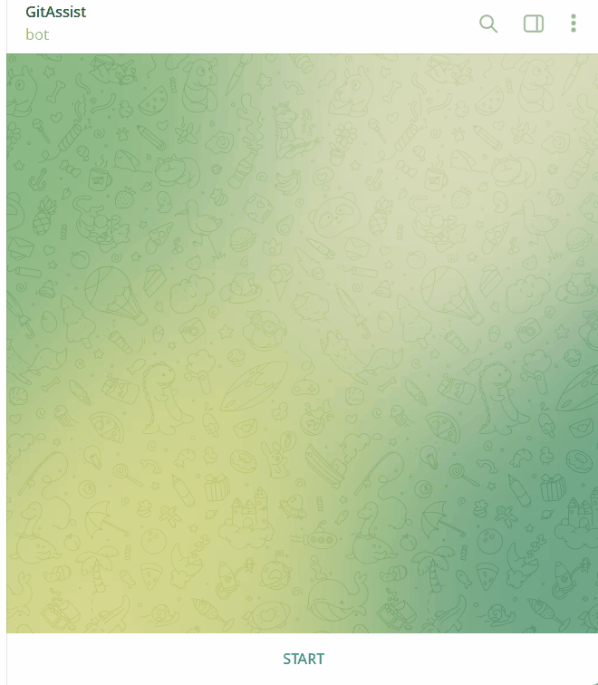

# GitAssist 🤖

**A Telegram bot for exploring GitHub repositories, issues, pull requests, and commits.**

GitAssist is a Telegram bot built with C# and .NET 9 that helps developers explore public GitHub repositories directly from Telegram.
Users can select a GitHub account, browse its repositories, and inspect repository information, open issues, pull requests, and commits without leaving Telegram.
The bot is running on a connected host to respond to Telegram messages.

> 🚧 **Status:** Early public preview (`v0.1.0`)
> The project is actively being developed, so features and APIs may change.

## 🎬 Demo

Here's a short demonstration of GitAssist in action.



## ✨ Features

### 📦 Repository Exploration

* Browse public repositories by GitHub username.
* View repository information, including description, programming language, stars, forks, open issues, and default branch.
* Switch between repositories or GitHub accounts.
* Navigate through repository pages.

### 🐛 Issues

* Browse open issues in a repository.
* View issue details, including title, description, author, labels, and timestamps.
* Navigate between issues using inline keyboard buttons.
* Move between pages of results.

### 🔀 Pull Requests

* Browse open pull requests.
* View pull request details, including status, author, branches, changed files, commits, additions, and deletions.
* Open pull requests directly on GitHub.
* Navigate through paginated results.

### 📝 Commits

* Browse recent commits.
* View commit messages, authors, timestamps, and change statistics.
* Inspect changed files and their additions and deletions.
* Open commits directly on GitHub.
* Navigate between pages of commits.

### ⚙️ Reliability and Configuration

* Centralized handling of GitHub API errors.
* GitHub rate-limit error handling.
* Structured logging with `ILogger`.
* Environment-based configuration for the Telegram bot token.
* Docker and Docker Compose support.
* The bot keeps the user's current conversation state and selected repository in memory while the application is running.

## 🛠️ Tech Stack

* **Language:** C#
* **Framework:** .NET 9
* **Bot Platform:** Telegram Bot API
* **External API:** GitHub REST API
* **Networking:** `HttpClient`
* **Dependency Injection:** .NET Generic Host
* **Logging:** `ILogger`
* **Containerization:** Docker and Docker Compose
* **Version Control:** Git and GitHub

## 🚀 Getting Started

### Prerequisites

To run GitAssist locally, you need:

* .NET 9 SDK
* A Telegram bot token
* Internet access to Telegram and the GitHub REST API

To run the project with Docker, you also need Docker Desktop or another working Docker Engine with Docker Compose.

### 1. Clone the Repository

```bash
git clone https://github.com/MaisDevelover-01/GitAssist.git
cd GitAssist
```

### 2. Configure the Telegram Bot Token

Create a Telegram bot using [BotFather](https://t.me/BotFather) and obtain its token.

Set the token as an environment variable.

**PowerShell:**

```powershell
$env:TELEGRAM_BOT_TOKEN = "YOUR_TELEGRAM_BOT_TOKEN"
```

Replace `YOUR_TELEGRAM_BOT_TOKEN` with your actual token.

Never commit your real bot token to GitHub.

### 3. Restore Dependencies

```bash
dotnet restore
```

### 4. Run the Application

```bash
dotnet run
```
Once the bot starts, open it in Telegram and send `/start`.

## Docker

GitAssist can be built and run inside a Docker container.

### Prerequisites

* Docker Desktop or Docker Engine
* A Telegram bot token obtained from [@BotFather](https://t.me/BotFather)

### Build the Docker Image

Clone the repository and navigate to the project directory:

```bash
git clone https://github.com/MaisDevelover-01/GitAssist.git
cd GitAssist
```

Build the Docker image:

```bash
docker build -t gitassist .
```

### Configure Environment Variables

Create a `.env` file in the project root directory:

```env
TELEGRAM_BOT_TOKEN=your_telegram_bot_token
```

Replace `your_telegram_bot_token` with your actual Telegram bot token.

**Security note:** Never commit your `.env` file or expose your bot token in source code, logs, screenshots, or public repositories.

Make sure `.env` is excluded by both `.gitignore` and `.dockerignore`.

### Run the Container

Start GitAssist using the environment variables from `.env`:

```bash
docker run -d \
  --name gitassist-local \
  -p 10000:10000 \
  --env-file .env \
  -e PORT=10000 \
  gitassist
```

The application exposes an HTTP health endpoint at:

```text
http://localhost:10000/health
```

A successful health check returns:

```json
{
  "status": "ok"
}
```

To inspect the container logs:

```bash
docker logs gitassist-local
```

To stop the container:

```bash
docker stop gitassist-local
```

The Docker image uses a multi-stage build to separate compilation from the final ASP.NET Core runtime image.

## Deployment

GitAssist can be deployed to [Render](https://render.com/) as a Docker-based Web Service.

### Deploy to Render

1. Push the project to a GitHub repository.

2. Open the [Render Dashboard](https://dashboard.render.com/).

3. Select **New → Web Service**.

4. Connect your GitHub account and select the `GitAssist` repository.

5. Choose the branch you want to deploy, usually `main`.

6. Select **Docker** as the runtime and specify the path to the project's `Dockerfile`.

7. Under **Environment Variables**, add the following variable:

   | Key                  | Value                   |
   | -------------------- | ----------------------- |
   | `TELEGRAM_BOT_TOKEN` | Your Telegram bot token |

8. Set the health check path to `/health`, if the option is available in the service settings.

9. Create the service and monitor the build and deployment logs.

Render builds the Docker image from the repository's `Dockerfile` and starts the application. The application reads the `PORT` environment variable to bind its HTTP server to the port provided by the hosting platform.

### Verify the Deployment

After deployment, open:

```text
https://YOUR-SERVICE-NAME.onrender.com/health
```

Replace `YOUR-SERVICE-NAME` with your actual Render service name.

A successful response should look like this:

```json
{
  "status": "ok"
}
```

The root endpoint `/` also returns a simple message confirming that the web server is running.

For more information, see the official [Render Docker deployment documentation](https://render.com/docs/docker) and [Web Services documentation](https://render.com/docs/web-services).

## 🧭 How it works

```text
Telegram User
     ↓
Telegram Bot
     ↓
CommandHandler
     ↓
GitHub Service
     ↓
GitHub REST API
```

## 📁 Project Structure

```text
GitAssist/
├── Bot/
│   ├── CommandHandler.cs
│   ├── TelegramBot.cs
│   ├── TelegramBotHosttedService.cs
│   ├── UserSession.cs
│   └── UserState.cs
│
├── Configuration/
│   └── BotSettings.cs
│
├── Models/
│   ├── ActiveRepository.cs
│   ├── CommitDetails.cs
│   ├── CommitsInfo.cs
│   ├── IssueInfo.cs
│   ├── PagedResult.cs
│   ├── PullRequestInfo.cs
│   ├── RepositoryInfo.cs
│   └── RepositorySummery.cs
│
├── Services/
│   ├── GitHubService.cs
│   ├── IGitHubService.cs
│   ├── GitHubApiException.cs
│   └── GitHubRateLimitException.cs
│
├── Program.cs
├── GitAssist.csproj
├── Dockerfile
├── docker-compose.yml
├── .dockerignore
├── .gitignore
|── Dockerfile
└── README.md
```

## Limitations

GitAssist is an educational and portfolio project. The following limitations apply to its current implementation:

* **Public repositories:** GitHub API requests are currently unauthenticated, so the bot is limited to publicly accessible repository data. Private repository access would require GitHub authentication.
* **GitHub API rate limits:** Unauthenticated GitHub REST API requests are generally limited to 60 requests per hour per IP address. GitAssist includes handling for GitHub API errors and rate-limit responses.
* **Read-only functionality:** The bot focuses on retrieving repository information, issues, and pull request data. Creating or modifying issues and pull requests is not currently supported.
* **In-memory session state:** User session information is stored in memory and may be lost when the application restarts or redeploys.
* **Free hosting limitations:** Free Render Web Services can spin down after 15 minutes without inbound traffic. Waking a service can take approximately one minute, so uninterrupted bot availability is not guaranteed.
* **Production readiness:** The project is intended for learning, experimentation, and demonstration purposes. Production use would require additional reliability, security, and monitoring considerations.

For the latest information about GitHub API limits, see the official [GitHub REST API rate-limit documentation](https://docs.github.com/en/rest/using-the-rest-api/rate-limits-for-the-rest-api).


## 🗺️ Roadmap

Potential future improvements include:

* Improved navigation and repository search.
* Support for additional GitHub resources.
* GitHub authentication and private repository access.
* Repository notifications and background monitoring.
* AI-assisted repository exploration and commit or pull request summaries.
* Further improvements to deployment, monitoring, and reliability.

## 🔐 Security

* Store the Telegram bot token in an environment variable.
* Do not commit `.env` or other files containing secrets.
* Keep credentials out of source code and container images.
* Review configuration and access permissions before deploying the bot.

## 🤝 Contributing

Issues and pull requests are welcome. If you find a bug or have an idea, open an issue and describe the expected behavior.

## 📄 License

No license has been added to this repository yet. All rights remain with the respective rights holders. A license can be added when the project's distribution and usage terms have been decided.

## 👤 Author

Built by **Masoume**.